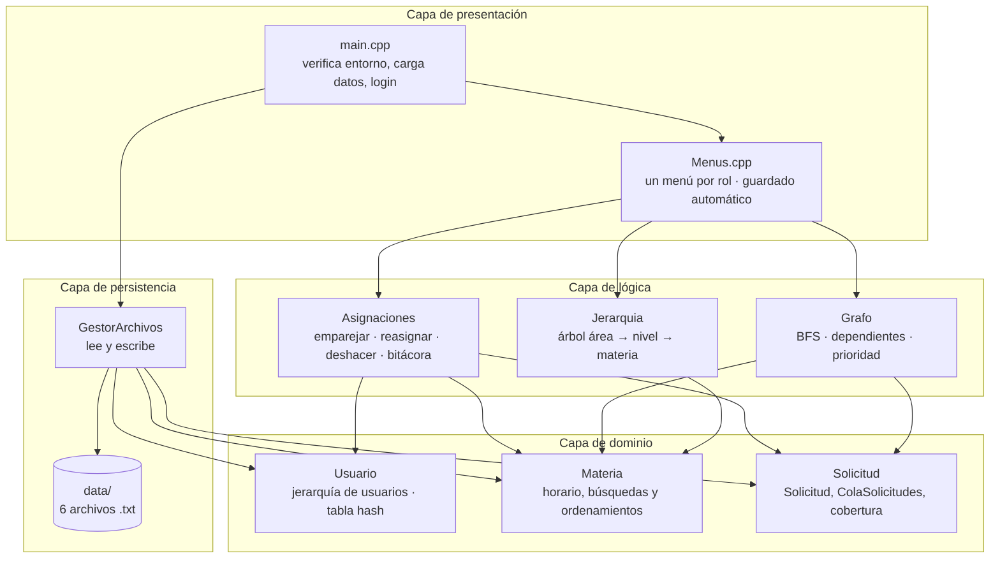
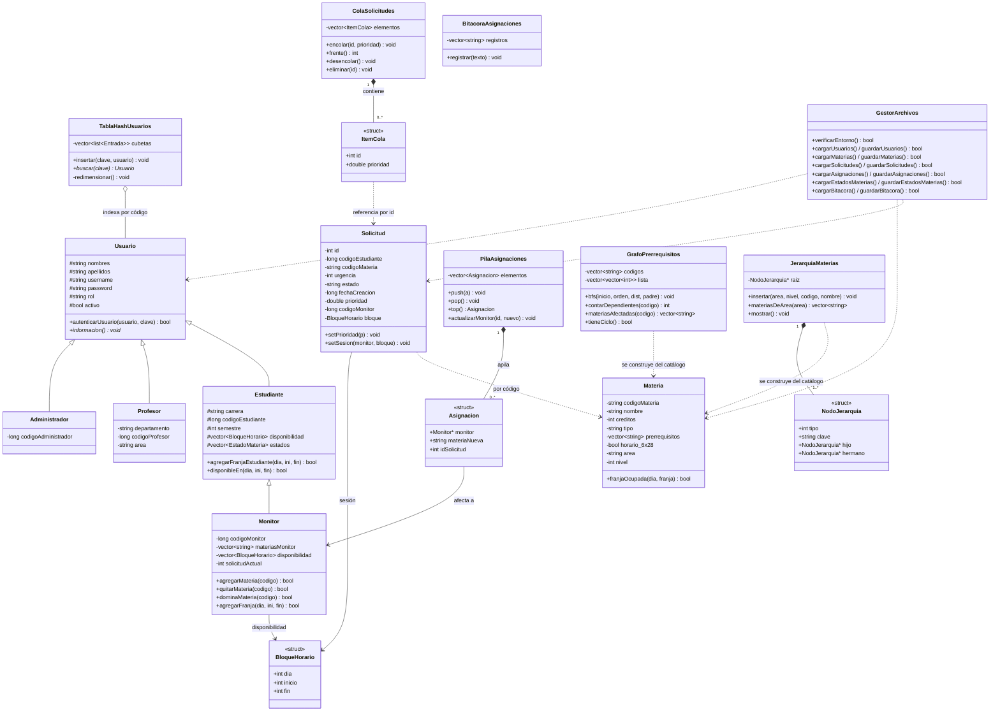
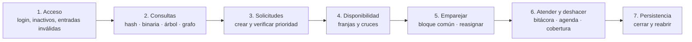
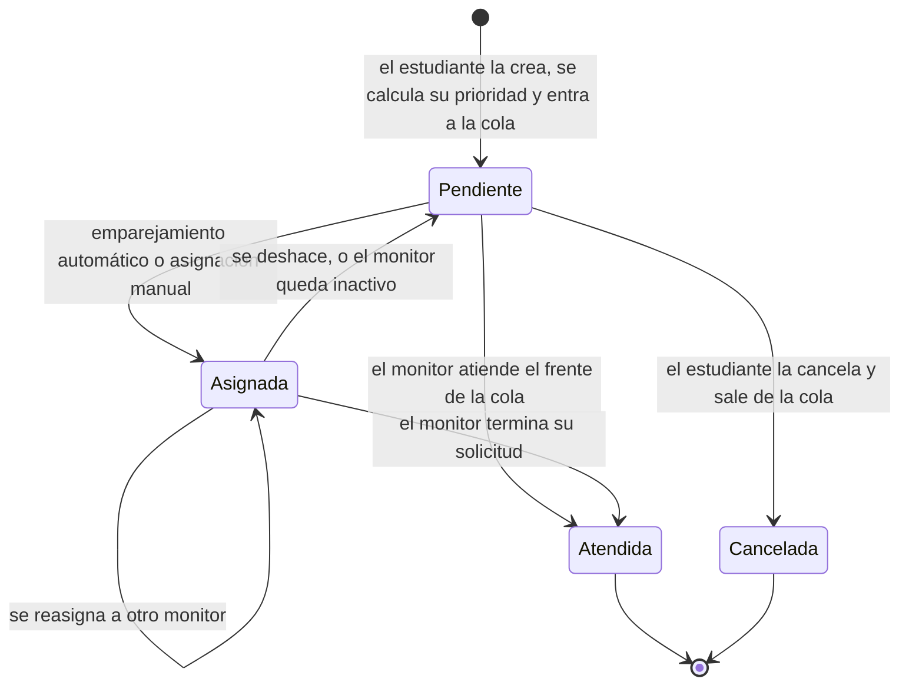

<h1 align="center">Sistema de Acompañamiento Académico</h1>

<p align="center">
  <b>Aplicación de consola en C++ para gestionar monitorías universitarias:</b><br>
  usuarios con roles, catálogo de materias con prerrequisitos, áreas y horarios, y una cola de solicitudes que se ordena con una <b>prioridad objetiva de tres criterios</b>.<br>
  Con estructuras de datos propias (<b>pila</b>, <b>cola con prioridad</b>, <b>tabla hash</b>, <b>árbol</b> y <b>grafo</b>) y algoritmos de <b>búsqueda</b>, <b>ordenamiento</b>, <b>recursión</b> y <b>BFS</b> que cuentan sus propias comparaciones.
</p>

<p align="center">
  
  
  
  
  
  
</p>

<p align="center">
  <a href="#qué-hace">Qué hace</a> ·
  <a href="#novedades-de-la-versión-final">Novedades</a> ·
  <a href="#inicio-rápido">Inicio rápido</a> ·
  <a href="#estructura-del-repositorio">Estructura</a> ·
  <a href="#arquitectura">Arquitectura</a> ·
  <a href="#cómo-funciona">Cómo funciona</a> ·
  <a href="#algoritmos-y-complejidad">Algoritmos</a> ·
  <a href="#formato-de-los-datos">Datos</a> ·
  <a href="#estado-de-los-requerimientos">Estado</a> ·
  <a href="#documentación">Documentación</a>
</p>

---

## Qué hace

Una universidad ofrece monitorías: estudiantes que ayudan a otros en una materia. Este sistema organiza todo ese flujo desde la terminal:

| Rol | Qué puede hacer |
|---|---|
| **Estudiante** | Ver materias, prerrequisitos y **horarios**, **crear solicitudes de monitoría** (la urgencia la calcula el sistema), ver su historial, cancelar pendientes y **definir su disponibilidad horaria** |
| **Monitor** | Ver la **cola de pendientes** en orden de atención, **atender la siguiente solicitud**, **terminar la solicitud asignada** y ver las solicitudes ordenadas por urgencia, antigüedad o materia |
| **Profesor** | Consultar **solo las materias de su área**: prerrequisitos, horarios, solicitudes y monitores que las atienden |
| **Administrador** | 30 opciones: registrar materias y usuarios, buscar materias (secuencial y binaria) y **estudiantes o monitores por código (tabla hash)**, asignar materias y solicitudes, **emparejar automáticamente** por horario, **reasignar**, **deshacer**, ver la **bitácora**, la **jerarquía de materias**, la **red de prerrequisitos**, las **materias afectadas al reprobar**, la **agenda semanal**, el **informe de cobertura** y activar o desactivar usuarios |

Los datos viven en archivos `.txt` y se **guardan después de cada acción**, así que el estado sobrevive entre ejecuciones aunque el programa se cierre de forma inesperada.

---

## Inicio rápido

**Requisitos:** un compilador de C++17 (`g++` 9 o superior; probado con **g++ 13.3**). En Windows se usa [MSYS2](https://www.msys2.org/) (`ucrt64`). Solo se usa la biblioteca estándar.

```bash
# 1. Clonar
git clone https://github.com/worksedu-prog/Algoritmos-2026-S2-PROYECTO.git
cd Algoritmos-2026-S2-PROYECTO

# 2. Compilar
g++ -std=c++17 -Wall Proyecto/main.cpp Proyecto/*/*.cpp -o Proyecto/Software

# 3. Ejecutar (desde la carpeta Proyecto, o desde la raíz: el programa encuentra data/ solo)
cd Proyecto
./Software          # en Windows: Software.exe
```

### Usuarios de prueba

Al arrancar, el programa muestra estas credenciales (existen en `data/usuarios.txt`):

| Rol | Usuario | Contraseña |
|---|---|---|
| Administrador | `admin` | `admin123` |
| Estudiante | `estudiante` | `estu123` |
| Monitor | `monitor` | `mon123` |
| Profesor | `profesor` | `prof123` |

---

## Pruébalo

Salidas reales del programa con los datos de `data/`, todas como administrador.

**Búsqueda de una materia** (opción `3`, `MAT101`): compara la búsqueda secuencial con la binaria.

```text
[MAT101] Calculo Diferencial - 4 creditos (Obligatoria) | Matematicas nivel 1
(secuencial: 5 comparaciones | binaria: 3 comparaciones)
```

**Materias afectadas al reprobar** (opción `19`, `MAT101`, motivo `1`): BFS sobre el grafo de prerrequisitos.

```text
Al reprobar MAT101 quedan bloqueadas 3 materia(s):
  nivel 1 (directas):
    - FIS201 Fisica Mecanica  (via MAT101)
  nivel 2 (indirectas):
    - FIS105 Fisica diferencial  (via FIS201)
  nivel 3 (indirectas):
    - CAL106 Calculo 1  (via FIS105)
```

**Lo que cuelga de un área** (opción `16`, `Fisica`): recorrido del árbol.

```text
Area: Fisica (2 materias)
  Nivel 1
    - [FIS201] Fisica Mecanica
  Nivel 2
    - [FIS105] Fisica diferencial
Total: 2 materia(s) en el area.
```

**Red de prerrequisitos** (opción `18`):

```text
Red de prerrequisitos (7 materias). A -> B: B requiere A
  FIS201 -> FIS105   [2 dependiente(s) en total]
  MAT101 -> FIS201   [3 dependiente(s) en total]
  PROG102 -> PROG201   [1 dependiente(s) en total]
  ...
La red es aciclica (DAG).
```

**Informe de cobertura** (opción `29`):

```text
Cobertura = atendidas / (solicitudes - canceladas) x 100
Total de solicitudes: 4
  Atendidas:               1
  Pendientes (sin cubrir): 2
  Canceladas (no cuentan): 1
Cobertura total: 33.3% (1 de 3 solicitudes vigentes)
```

---

## Estructura del repositorio

```text
Algoritmos-2026-S2-PROYECTO/
├── README.md
├── Documentacion/                  Informe IEEE, diagramas, complejidad y casos de prueba
└── Proyecto/
    ├── main.cpp                    Verifica el entorno, carga datos, sanea asignaciones, arma la cola y abre el login
    ├── Usuario/                    Usuario → Administrador, Estudiante → Monitor, Profesor · TablaHashUsuarios
    ├── Materia/                    Materia con área, nivel y horario 6×28 · búsquedas · inserción, merge y quick sort
    ├── Solicitud/                  Solicitud · ColaSolicitudes · merge sort de solicitudes · resumen de cobertura
    ├── Asignaciones/               Pila de deshacer · bitácora · bloque común · emparejamiento · reasignación
    ├── Grafo/                      Red de prerrequisitos (BFS) y cálculo de la prioridad
    ├── Jerarquia/                  Árbol Área → Nivel → Materia
    ├── GestorArchivos/             Lectura y escritura de los seis archivos de data/
    ├── Menus/                      Un menú por rol y guardado automático tras cada acción
    └── data/                       usuarios · materias · solicitudes · asignaciones · estados_materias · bitacora (.txt)
```

> `Software.exe` es un binario de Windows compilado previamente; se regenera con el comando de compilación.

---

## Arquitectura

### Diagrama de arquitectura

El sistema se organiza en cuatro capas. Cada capa solo habla con la de al lado, así que cambiar cómo se guardan los datos (por ejemplo, pasar de `.txt` a una base de datos) no obligaría a tocar los menús.



`main` verifica que exista `data/`, carga los seis archivos, ordena las materias por código (requisito de la búsqueda binaria) y sanea las asignaciones: una solicitud `Asignada` sin bloque guardado, o cuyo monitor está inactivo, vuelve a `Pendiente` y queda registrada en la bitácora. Luego calcula la prioridad de cada pendiente, arma la cola y entra al bucle de inicio de sesión.

### Diagrama de clases



- Un **Monitor es un Estudiante** que además atiende una lista de materias y tiene su propia disponibilidad.
- Los usuarios viven en un único `vector<Usuario*>`. Además se mantienen **dos tablas hash** (estudiantes y monitores) que apuntan a esos mismos objetos, para buscarlos por código sin recorrer el vector.
- Las clases se relacionan **por código o por id**, así los datos se guardan como texto plano sin referencias frágiles. La excepción es `Asignacion`, que apunta al monitor real para que "deshacer" actúe sobre el objeto verdadero.
- La **sesión** de una monitoría no es un objeto aparte que se guarde: es una vista de la solicitud asignada (monitor + bloque), lo que deja una sola fuente de verdad.
- El grafo y el árbol **se reconstruyen desde el catálogo** cuando se necesitan, así nunca quedan desincronizados de `materias.txt`.

### Flujo de pruebas

Las pruebas siguen el recorrido natural de una monitoría, de menor a mayor complejidad:



La matriz completa está en [`casos_prueba_HU-JH.xlsx`](Documentacion/casos_prueba_HU-JH.xlsx): **68 casos sobre 18 historias de usuario, 59 pasan, 0 fallan y 9 siguen pendientes** (HU-33, HU-34 y HU-36).

---

## Cómo funciona

### Ciclo de vida de una solicitud



### Prioridad con tres criterios

La urgencia ya no la declara el estudiante, porque eso era justo lo que alimentaba la percepción de favoritismo. Cada solicitud pendiente recibe un puntaje entre 0 y 1:

```
P = 0,30 · P1 (semestre)  +  0,40 · P2 (dependencia)  +  0,30 · P3 (antigüedad)
```

| Criterio | Cálculo | Idea |
|---|---|---|
| **P1 – Semestre** | 1 si el estudiante está en 1–2 u 8–9; 0 en otro caso | Atender primero a quien apenas se adapta y a quien está por graduarse |
| **P2 – Dependencia** | `d / dmáx`, con `d` = materias que dependen de la solicitada (BFS en el grafo) | Una materia de la que cuelga medio plan pesa más |
| **P3 – Antigüedad** | 0 hoy · 0,25 con 1–2 días · 0,45 con 3 · 0,6 con 4–6 · 1 desde 7 días | Ninguna solicitud se queda esperando para siempre |

La urgencia que se muestra se deriva del puntaje: **Alta** si P ≥ 0,66, **Media** si P ≥ 0,33 y **Baja** en otro caso. La cola se mantiene ordenada de mayor a menor prioridad y, a igual prioridad, va primero la más antigua (id menor), de modo que una solicitud reencolada al deshacer recupera su lugar.

### Emparejamiento sin cruces

`buscarBloqueComun` recorre la disponibilidad del monitor y busca el primer bloque de **1 hora** (2 franjas de 30 min) que:

1. cabe en la disponibilidad del estudiante (si la registró),
2. no se cruza con la clase de la materia,
3. no se cruza con otra sesión del mismo monitor ni del mismo estudiante.

El emparejamiento automático (opción `21`) prueba con cada monitor **activo**, **libre** y que **domine la materia**. Si ninguno sirve, la solicitud sigue pendiente y no se cambia nada.

### La pila de asignaciones y la bitácora

Cada asignación (una materia a un monitor, o una solicitud a un monitor) se apila. **Deshacer** hace `pop` y revierte: la materia se le quita al monitor, o la solicitud vuelve a `Pendiente`, regresa a la cola y libera al monitor. Al **reasignar**, las entradas de la pila se actualizan al nuevo monitor para que deshacer después libere al correcto.

La **bitácora** es de solo agregar y ahora se guarda en `bitacora.txt`: deshacer **no** borra nada, así que queda el rastro completo de cada asignación y reversión, incluso entre ejecuciones.

### Grafo y jerarquía

- **Grafo:** cada materia es un vértice y hay una arista `A → B` cuando A es prerrequisito de B. Un BFS desde una materia da, por niveles, todo lo que queda bloqueado si se reprueba o retira. El administrador puede aplicarlo al historial de un estudiante (opción `24`).
- **Árbol:** Catálogo → Área → Nivel → Materia. Los hermanos se insertan ordenados, así que el recorrido en preorden imprime la jerarquía ya ordenada.

### Horarios de materias

Cada materia tiene una matriz `horario[6][28]`: 6 días (lunes a sábado) × 28 franjas de 30 minutos (6:00 AM a 8:00 PM). Al mostrarla, el sistema **une las franjas consecutivas en bloques** (`Martes, 10:00 AM - 12:00 PM`). En el archivo se guarda de forma compacta: `1@4-10|3@8-14`.

---

## Algoritmos y complejidad

Las búsquedas y ordenamientos **cuentan sus comparaciones** y las muestran en pantalla.

| Algoritmo / estructura | Dónde se usa | Complejidad |
|---|---|---|
| **Tabla hash** (encadenamiento) | Estudiantes y monitores por código | O(1) promedio · O(n) peor |
| Búsqueda secuencial | Materias y solicitudes por id | O(n) |
| Búsqueda binaria | Materias por código; vértices del grafo | O(log n) |
| Ordenamiento por **inserción** | Listado de materias; agenda semanal | O(n²) · O(n) casi ordenado |
| **Merge sort** | Orden inicial por código; listados | O(n log n) |
| **Quick sort** | Listado de materias (pivote central) | O(n log n) promedio |
| **Merge sort de solicitudes** | Por urgencia, antigüedad o materia | O(s log s) |
| **Recursión** sobre prerrequisitos | Cadena hacia atrás de una materia | O(k · log n) |
| **BFS** en el grafo | Dependientes y materias afectadas | O(V + E) |
| Detección de ciclos | Validar que el plan sea cursable | O(V + E) |
| Recorridos del **árbol** (preorden/postorden) | Jerarquía, materias de un área, liberar memoria | O(nodos) |
| Recalcular prioridades | Al iniciar y desde la opción `20` | O(s·(V + E) + s·q) |
| Buscar bloque común | Emparejar y reasignar | O(F · S) |
| Encolar / desencolar · `frente` | Cola de solicitudes | O(q) · O(1) |
| `push` / `pop` | Pila de asignaciones | O(1) |

*n = materias, s = solicitudes, q = tamaño de la cola, V y E = vértices y aristas del grafo, F = franjas de disponibilidad, S = sesiones asignadas, k = prerrequisitos visitados.* La justificación método por método está en [`Tabla_de_complejidad_proyecto.xlsx`](Documentacion/Tabla_de_complejidad_proyecto.xlsx).

---

## Formato de los datos

Archivos de texto separados por comas, en `Proyecto/data/`. Las columnas nuevas son opcionales, así que los archivos de versiones anteriores se siguen leyendo.

**`materias.txt`**
```text
Codigo,Nombre,Creditos,Tipo,Prerrequisitos(;),Horario,Area,Nivel
FIS105,Fisica diferencial,3,Obligatoria,FIS201,1@8-12|4@4-8,Fisica,2
```
El horario son bloques `dia@inicio-fin` separados por `|`. Día: `0` = lunes … `5` = sábado. Franja: `0` = 6:00 AM, y cada una dura 30 minutos.

**`solicitudes.txt`**
```text
Id,CodigoEstudiante,CodigoMateria,Urgencia(1-3),Estado,FechaCreacion(epoch),Descripcion
1,1,MAT101,2,Pendiente,1795439714,Refuerzo en integrales definidas
```
La descripción es el último campo, así que **puede contener comas**. Estados: `Pendiente`, `Asignada`, `Atendida`, `Cancelada`.

**`usuarios.txt`**: las columnas finales dependen del rol.
```text
Administrador,Nombres,Apellidos,Usuario,Clave,Activo,CodigoAdmin
Estudiante,...,Activo,CodigoEst,Carrera,Semestre,Franjas
Monitor,...,Activo,CodigoEst,Carrera,Semestre,CodigoMonitor,Horario,Materias(;),Reservada,Franjas(|)
Profesor,...,Activo,Departamento,CodigoProfesor,Area
```

**Archivos nuevos**

| Archivo | Formato |
|---|---|
| `asignaciones.txt` | `IdSolicitud,CodigoMonitor,dia@inicio-fin` |
| `estados_materias.txt` | `CodigoEstudiante,CodigoMateria,Estado` |
| `bitacora.txt` | Una línea por registro |

> Si falta `data/` o `usuarios.txt`, el programa lo avisa antes de iniciar y no arranca.

---

## Estado de los requerimientos

| # | Requerimiento | Oct. 2026 | Final |
|---|---|---|---|
| 1 | Registro de usuarios y materias con disponibilidad | Parcial | ✅ Cumplido |
| 2 | Solicitudes de monitoría e historial | Cumplido | ✅ Cumplido |
| 3 | Cola con prioridad | Cumplido | ✅ Cumplido (3 criterios) |
| 4 | Revertir asignaciones (pila) y bitácora | Cumplido | ✅ Cumplido (bitácora persistente) |
| 5 | Búsqueda inmediata por código | Pendiente | ✅ Cumplido (tabla hash) |
| 6 | Ordenamientos | Cumplido | ✅ Cumplido |
| 7 | Jerarquía de materias por área y nivel | Pendiente | ✅ Cumplido (árbol) |
| 8 | Red de prerrequisitos | Parcial | ✅ Cumplido (grafo + BFS) |
| 9 | Agenda semanal sin cruces e informe de cobertura | Parcial | ✅ Cumplido |

**Requerimientos no funcionales:** RNF-03 (sin internet ni base de datos) y RNF-04 (código documentado) se cumplen. RNF-02 (búsqueda en tiempo constante) quedó resuelto con la tabla hash. RNF-01 (500 registros) y RNF-05 (versión en Python) no se realizaron, por acuerdo con el equipo docente.

### Limitaciones conocidas

- Las contraseñas se guardan en texto plano.
- `Menus.cpp` conserva una versión antigua de `cambiarEstadoUsuario` sin uso, que produce la única advertencia del compilador.
- `GrafoPrerrequisitos::mostrarCadena` (camino más corto entre dos materias) está implementado, pero ningún menú lo llama.
- `Solicitud::mostrarInfo` todavía no muestra el monitor ni el bloque de la sesión.

---

## Documentación

Todo el material de apoyo vive en la carpeta [`Documentacion/`](Documentacion/):

| Archivo | Qué contiene |
|---|---|
| [`Proyecto-Informe-IEEE.pdf`](Documentacion/Proyecto-Informe-IEEE.pdf) | Informe final en formato IEEE: arquitectura, novedades, estado de los RF y RNF, complejidad, pruebas y limitaciones |
| [`Tabla_de_complejidad_proyecto.xlsx`](Documentacion/Tabla_de_complejidad_proyecto.xlsx) | Big O de cada método, con su justificación |
| [`casos_prueba_HU-JH.xlsx`](Documentacion/casos_prueba_HU-JH.xlsx) | 68 casos de prueba por historia de usuario, resumen y flujos |
| Diagramas en PNG: `1_arquitectura.png`, `2_clases.png`, `3_flujo_de_pruebas.png` | Exportados del código Mermaid de este README |

Los diagramas del README están escritos en Mermaid y se ven directamente en GitHub. Para exportarlos a imagen se puede usar [`mermaid-cli`](https://github.com/mermaid-js/mermaid-cli): `mmdc -i diagrama.mmd -o Documentacion/diagrama.png -s 3 -b white`.

---

<p align="center">
  Proyecto del curso <b>Algoritmos y Estructuras de Datos</b> · Universidad del Rosario · 2026-S2<br>
  <b>Julian David Hernández</b> · <b>David Santiago Arteaga</b><br>
  Docente: Tatiana Cabrera
</p>
