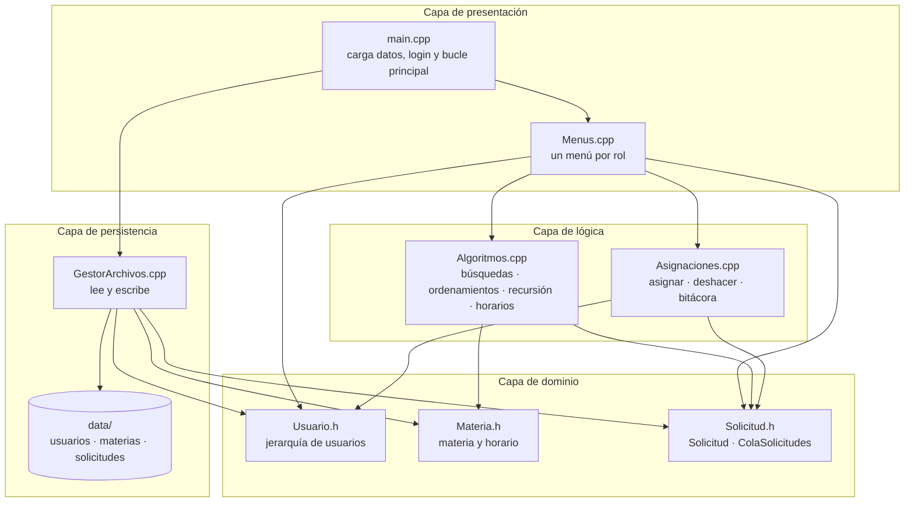
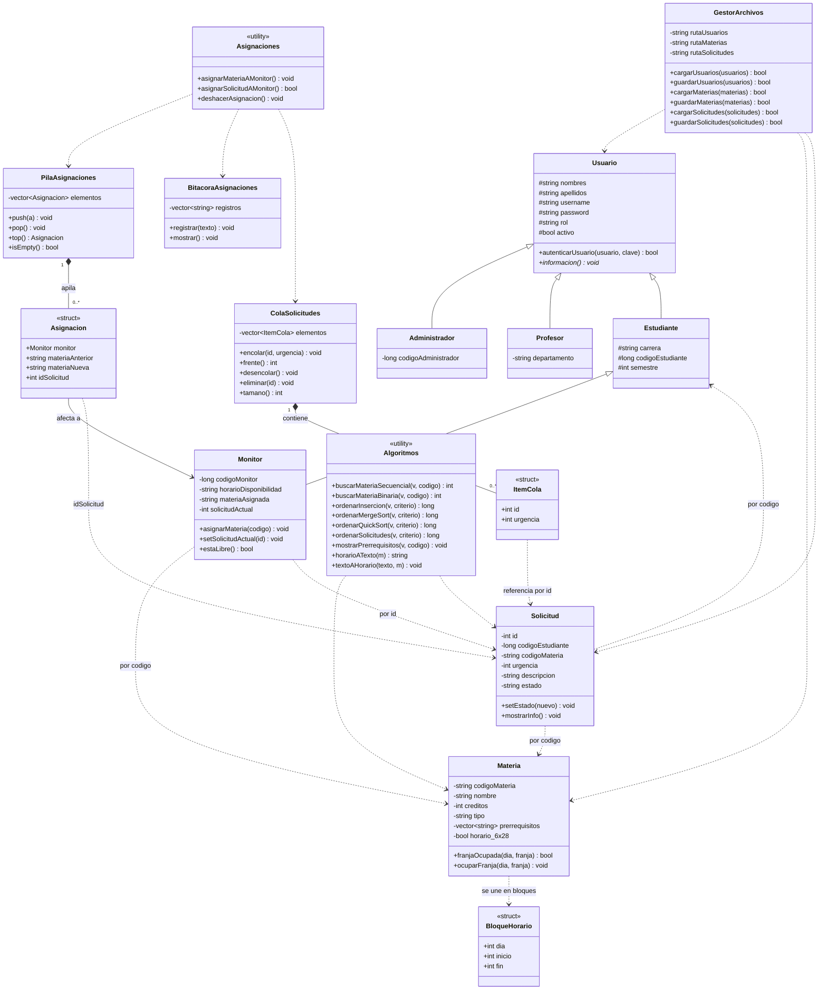
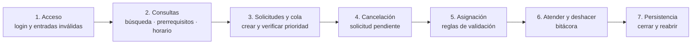
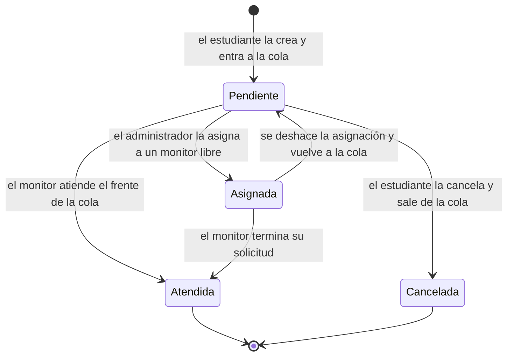

<h1 align="center">Sistema de Acompañamiento Académico</h1>

<p align="center">
  <b>Aplicación de consola en C++ para gestionar monitorías universitarias:</b><br>
  usuarios con roles, catálogo de materias con prerrequisitos y horarios, y una cola de solicitudes que atiende primero lo más urgente.<br>
  Con estructuras de datos propias (<b>pila</b> y <b>cola con prioridad</b>) y algoritmos de <b>búsqueda</b>, <b>ordenamiento</b> y <b>recursión</b> que cuentan sus propias comparaciones.
</p>

<p align="center">
  
  
  
  
  
</p>

<p align="center">
  <a href="#qué-hace">Qué hace</a> ·
  <a href="#inicio-rápido">Inicio rápido</a> ·
  <a href="#arquitectura">Arquitectura</a> ·
  <a href="#cómo-funciona">Cómo funciona</a> ·
  <a href="#algoritmos-y-complejidad">Algoritmos</a> ·
  <a href="#formato-de-los-datos">Datos</a> ·
  <a href="#estado-de-los-requerimientos">Estado</a> ·
  <a href="#documentación">Documentación</a>
</p>

---

## Qué hace

Una universidad ofrece monitorías: estudiantes que ayudan a otros en una materia. Este sistema organiza todo ese flujo desde la terminal:

| Rol | Qué puede hacer |
|---|---|
| **Estudiante** | Ver materias ordenadas a su gusto, consultar prerrequisitos y **horarios**, **crear solicitudes de monitoría** con nivel de urgencia, ver su historial y cancelar solicitudes pendientes |
| **Monitor** | Ver la **cola de pendientes** en orden de atención, **atender la siguiente solicitud**, **terminar la solicitud que el administrador le asignó** y ver las solicitudes ordenadas por urgencia, antigüedad o materia |
| **Profesor** | Consultar materias, prerrequisitos, horarios, solicitudes por materia y qué monitor tiene asignada cada materia |
| **Administrador** | Registrar materias (con código autogenerado y prerrequisitos) y usuarios, buscar por código, **asignar materias a monitores**, **asignar solicitudes pendientes a un monitor libre**, **deshacer la última asignación**, consultar la **bitácora** de asignaciones y reversiones, y ordenar solicitudes |

Los datos viven en archivos `.txt`: se cargan al iniciar y se guardan al cerrar, así que el estado sobrevive entre ejecuciones.

---

## Inicio rápido

**Requisitos:** un compilador de C++ (`g++` con soporte C++11 o superior). En Windows se usa [MSYS2](https://www.msys2.org/) (`ucrt64`), igual que en la configuración de VS Code incluida.

```bash
# 1. Clonar
git clone <url-del-repositorio>
cd Algoritmos-2026-S2-PROYECTO

# 2. Compilar
g++ -std=c++17 -g Proyecto/src/*.cpp -o Proyecto/src/Software

# 3. Ejecutar (desde la carpeta src, o desde la raíz: el programa encuentra data/ solo)
cd Proyecto/src
./Software          # en Windows: Software.exe
```

> **Con VS Code:** abre la carpeta y presiona `F5`. La tarea `C/C++: Compilar Proyecto (Software.exe)` compila todo y el depurador `gdb` lo lanza (rutas de MSYS2 en `.vscode/`; ajústalas si instalaste el compilador en otro lugar).

### Usuarios de prueba

Al arrancar, el programa muestra estas credenciales (existen en `data/usuarios.txt`):

| Rol | Usuario | Contraseña |
|---|---|---|
| Administrador | `admin` | `admin123` |
| Estudiante | `estudiante` | `estu123` |
| Monitor | `monitor` | `mon123` |
| Profesor | `profesor` | `prof123` |

---

## Pruébalo

Sesión real como administrador, comparando los dos tipos de búsqueda (opción `3`, buscando `MAT101`):

```text
Seleccione una opcion: 3
Codigo a buscar: MAT101
[MAT101] Calculo Diferencial - 4 creditos (Obligatoria)
(secuencial: 5 comparaciones | binaria: 3 comparaciones)
```

La recursión sobre prerrequisitos (opción `4`, materia `FIS105`):

```text
Fisica diferencial:
  - FIS201 Fisica Mecanica
    - MAT101 Calculo Diferencial
```

El horario de una materia (opción `12`, materia `FIS105`), dibujado como cuadrícula día × franja de 30 minutos:

```text
  Hora      Lunes      Martes     Miercoles  Jueves     Viernes    Sabado
  8:00 AM   .          .          .          .          [X]        .
  8:30 AM   .          .          .          .          [X]        .
  9:00 AM   .          .          .          .          [X]        .
  9:30 AM   .          .          .          .          [X]        .
  10:00 AM  .          [X]        .          .          .          .
  ...
Bloques:
  Martes, 10:00 AM - 12:00 PM
  Viernes, 8:00 AM - 10:00 AM
```

El recorrido completo de una monitoría (crear, priorizar, asignar, deshacer y guardar) está en el [flujo de pruebas](#flujo-de-pruebas).

---

## Arquitectura

### Diagrama de arquitectura

El sistema se organiza en cuatro capas. Cada capa solo habla con la de al lado, así que cambiar cómo se guardan los datos (por ejemplo, pasar de `.txt` a una base de datos) no obligaría a tocar los menús.



`main` carga los tres archivos, ordena las materias por código (requisito de la búsqueda binaria), reconstruye la cola con las solicitudes que siguen pendientes y entra al bucle de inicio de sesión. Al salir, guarda todo y libera la memoria dinámica de los usuarios.

### Diagrama de clases



- Un **Monitor es un Estudiante** con horario, una materia asignada y la solicitud que tiene en curso (`solicitudActual`, `0` = libre).
- Los usuarios viven en un único `vector<Usuario*>`. Al iniciar sesión, el rol decide a qué clase se hace el `static_cast` y qué menú se abre. El registro y la persistencia usan `dynamic_cast` para distinguir tipos (probando `Monitor` antes que `Estudiante`, porque un monitor también es estudiante).
- Las clases se relacionan **por código o por id** (una solicitud guarda el código de su materia, no un puntero). Por eso los datos se guardan como texto plano sin referencias frágiles. La única excepción es `Asignacion`, que apunta al monitor real para que "deshacer" actúe sobre el objeto verdadero.
- `Algoritmos` y `Asignaciones` agrupan **funciones libres**, no clases. Se dibujan como `<<utility>>` para mostrar qué usan.

### Flujo de pruebas

Las pruebas siguen el recorrido natural de una monitoría, de menor a mayor complejidad:



Resultados verificados ejecutando el programa con los archivos de `data/` originales:

| # | Rol y opción | Entrada | Resultado verificado |
|---|---|---|---|
| 1 | Inicio de sesión | `admin` con clave incorrecta | `Usuario o contrasena incorrectos.` y vuelve al inicio |
| 2 | Inicio de sesión | `admin` / `admin123` | Abre el menú del Administrador |
| 3 | Cualquier menú | Escribir `abc` | `Opcion invalida.` sin cerrarse ni colgarse |
| 4 | Admin, `3` | `MAT101` | Encuentra la materia: 5 comparaciones secuencial y 3 binaria |
| 5 | Admin, `4` | `FIS105` | Cadena `FIS201` → `MAT101`, con sangría por nivel |
| 6 | Admin, `12` | `FIS105` | `Martes, 10:00 AM - 12:00 PM` y `Viernes, 8:00 AM - 10:00 AM` |
| 7 | Estudiante, `3` | `FIS105` urgencia 3 · `MAT101` urgencia 1 | `Solicitud #5 creada` y `Solicitud #6 creada` |
| 8 | Monitor, `2` | Ver la cola | Orden: #5 (Alta), #1 (Media), #4 (Media), #6 (Baja). A igual urgencia, la más antigua primero |
| 9 | Estudiante, `5` | Cancelar #4, y otra vez #4 | `Solicitud #4 cancelada.` y luego `Solo se pueden cancelar solicitudes pendientes.` |
| 10 | Admin, `6` | `monitor`, `MAT101` | `Se asigno la materia MAT101 a Julian.` |
| 11 | Admin, `9` | `monitor`, solicitud #5 (`FIS105`) | `El monitor no atiende la materia FIS105.` y no se asigna |
| 12 | Admin, `9` | `monitor`, solicitud #1 (`MAT101`) | `Solicitud #1 asignada a Julian.` y pasa a `Asignada` |
| 13 | Admin, `9` | `monitor`, solicitud #6 | `El monitor ya tiene asignada la solicitud #1.` |
| 14 | Admin, `7` | Deshacer | La solicitud vuelve a la cola como `Pendiente` y el monitor queda libre |
| 15 | Admin, `10` | Ver bitácora | 3 registros: asignación de materia, asignación de solicitud y reversión |

Casos que parten de nuevo de los datos originales:

| # | Rol y opción | Entrada | Resultado verificado |
|---|---|---|---|
| 16 | Admin `6` y `9`, luego Monitor `4` | Asignar #1 y terminarla | La solicitud pasa a `Atendida` y la franja del monitor queda libre |
| 17 | Admin, `7` | Deshacer tras atender | `No se puede deshacer: la solicitud #1 ya no esta asignada (fue atendida).` |
| 18 | Monitor, `5` | Ordenar por urgencia (`1`) | Alta primero y `(merge sort: 4 comparaciones)` |
| 19 | Cerrar y reabrir | Salir con #1 en `Asignada` | En el archivo queda `Asignada`; al reiniciar vuelve a `Pendiente` y aparece en la cola |

---

## Cómo funciona

### Ciclo de vida de una solicitud



Para asignar una solicitud el sistema exige que exista, que esté `Pendiente`, que el monitor atienda **esa materia** y que esté **libre**. Si algo falla, no se cambia nada.

### La cola con prioridad

`ColaSolicitudes` es una cola propia (sobre un `vector`) que se mantiene **ordenada por urgencia, de mayor a menor**. Al encolar, se avanza mientras el elemento actual tenga mayor urgencia, o la misma urgencia pero un id menor (más antigua), y se inserta ahí. Eso da tres garantías:

- Una solicitud **Alta** siempre pasa delante de las **Media** y **Baja**.
- Entre solicitudes de la **misma urgencia** se respeta el orden de llegada.
- Una solicitud **reencolada** al deshacer una asignación recupera su lugar por antigüedad, en vez de quedar al final de su urgencia.

Al reiniciar el programa, la cola se reconstruye a partir de las solicitudes con estado `Pendiente`.

### La pila de asignaciones y la bitácora

Cada vez que el administrador asigna algo (una materia a un monitor, o una solicitud a un monitor libre), se apila un registro con el monitor, la materia anterior, la nueva y el id de la solicitud (`0` si solo cambió la materia). **Deshacer** hace `pop` y revierte según el tipo:

- **Asignación de materia:** se restaura la materia anterior.
- **Asignación de solicitud:** la solicitud vuelve a `Pendiente`, regresa a la cola y el monitor queda libre. Si ya fue atendida, no se puede "des-atender" y el sistema lo avisa.

La **bitácora** es un registro de solo agregar: deshacer **no** borra nada de ella, así que queda el rastro completo de cada asignación y reversión.

### Horarios de materias

Cada materia tiene una matriz `horario[6][28]`: 6 días (lunes a sábado) × 28 franjas de 30 minutos (6:00 AM a 8:00 PM). Al mostrarla, el sistema recorre cada día y **une las franjas ocupadas consecutivas en bloques** (`Martes, 10:00 AM - 12:00 PM`). En el archivo se guarda de forma compacta: `1@4-10|3@8-14` significa "día 1 de la franja 4 a la 10, y día 3 de la 8 a la 14".

---

## Algoritmos y complejidad

Las búsquedas y ordenamientos **cuentan sus comparaciones** y las muestran en pantalla, para poder comparar algoritmos con datos reales en lugar de solo con teoría.

| Algoritmo | Dónde se usa | Complejidad | Notas |
|---|---|---|---|
| Búsqueda secuencial | Materias y solicitudes por id | O(n) | No exige orden |
| Búsqueda binaria | Materias por código (validaciones, prerrequisitos, horarios, generación de códigos) | O(log n) | Exige el vector ordenado por código |
| Ordenamiento por **inserción** | Insertar una materia nueva en su lugar; opción del listado | O(n²) · O(n) si está casi ordenado | Básico |
| Ordenamiento **merge sort** | Orden inicial por código al arrancar; opción del listado | O(n log n) | Recursivo, usa memoria auxiliar |
| Ordenamiento **quick sort** | Opción del listado | O(n log n) promedio | Recursivo, pivote central para evitar el peor caso en datos ya ordenados |
| **Merge sort de solicitudes** | Listar solicitudes por urgencia, antigüedad o materia | O(s log s) | Siempre desempata por id, así el resultado es determinista |
| **Recursión** sobre prerrequisitos | Cadena completa de prerrequisitos de una materia | O(k · log n), k = prerrequisitos visitados | Caso base: materia sin prerrequisitos |
| Horario: bloques y texto | Mostrar, guardar y cargar horarios | O(días × franjas) = constante (6 × 28) | Une franjas consecutivas en bloques |
| Encolar / desencolar | Cola de solicitudes | O(q) · `frente` O(1) | Implementada sobre vector |
| `push` / `pop` | Pila de asignaciones | O(1) | |

Medido con los algoritmos reales sobre 1000 materias desordenadas: inserción **245,345** comparaciones, merge sort **8,714** y quick sort **12,106**. Buscando la última de 1000 materias: **1000** comparaciones la secuencial contra **10** la binaria.

### Tabla de complejidad por método

Detalle de cada método del proyecto. Se puede abrir y filtrar en Excel: [`Tabla_de_complejidad_proyecto.xlsx`](Documentacion/Tabla_de_complejidad_proyecto.xlsx).

| Módulo | Método | Qué hace | Big O | Por qué |
|---|---|---|---|---|
| Materia (horario) | `franjaOcupada(dia, franja)` | Dice si una franja de 30 min está ocupada | **O(1)** | Accede directo a horario[dia][franja]: el índice calcula la posición en memoria, sin recorrer la matriz |
|  | `ocuparFranja(dia, franja)` | Marca una franja como ocupada | **O(1)** | Escribe true en horario[dia][franja], una sola asignación |
|  | `bloquesDeHorario(m)` | Une franjas consecutivas en bloques (ej. Martes 10:00-12:00) | **O(D · F)** | Recorre la matriz completa: D días por F franjas (6 × 28, constantes). No depende del número de materias |
|  | `mostrarMatrizHorario(m)` | Dibuja la cuadrícula día × franja | **O(D · F)** | Visita cada celda una vez |
|  | `horarioATexto(m) / textoAHorario(t, m)` | Convierte el horario a texto para guardarlo y de texto a horario al cargar | **O(D · F) / O(L)** | Guardar recorre la matriz; cargar recorre los L caracteres del texto y ocupa cada franja una vez |
| ColaSolicitudes | `encolar(id, urgencia)` | Inserta la solicitud en su lugar: mayor urgencia primero y, a igual urgencia, la más antigua | **O(q)** | Avanza hasta encontrar la posición (hasta q pasos) y insert desplaza los elementos de la derecha |
|  | `frente()` | Devuelve el id de la solicitud que sigue | **O(1)** | Lee la primera posición del vector |
|  | `desencolar()` | Saca la solicitud del frente | **O(q)** | erase en la posición 0 desplaza los q-1 elementos restantes. Con una lista enlazada sería O(1) |
|  | `eliminar(id)` | Saca una solicitud de cualquier posición (cancelar) | **O(q)** | Busca el id recorriendo la cola y luego desplaza los elementos |
|  | `estaVacia() / tamano()` | Informa si la cola está vacía y cuántas solicitudes tiene | **O(1)** | Solo consulta el tamaño del vector |
| PilaAsignaciones | `push(a)` | Apila una asignación (materia o solicitud) | **O(1) amortizado** | Escribe al final; solo copia todo cuando el vector interno se llena |
|  | `pop()` | Desapila la última asignación | **O(1)** | Quita el último elemento sin desplazar nada |
|  | `top() / isEmpty()` | Consulta la cima y si la pila está vacía | **O(1)** | Acceso directo al último elemento |
| BitacoraAsignaciones | `registrar(texto)` | Agrega una línea de registro | **O(1) amortizado** | Escribe al final del vector |
|  | `mostrar()` | Imprime todos los registros en orden | **O(r)** | Visita cada uno de los r registros una vez |
| Asignaciones | `asignarMateriaAMonitor()` | Asigna una materia a un monitor y la registra | **O(1) amortizado** | Cambia un campo del monitor, apila (push) y registra en la bitácora. Las búsquedas de monitor y materia se hacen antes, en el menú |
|  | `asignarSolicitudAMonitor()` | Asigna una solicitud pendiente a un monitor libre | **O(s + q)** | buscarSolicitudSecuencial recorre las s solicitudes y sacar la solicitud de la cola cuesta O(q) |
|  | `deshacerAsignacion()` | Revierte la última asignación con la pila | **O(s + q)** | pop es O(1), pero localizar la solicitud es O(s) y reencolarla es O(q) |
| Búsqueda | `buscarMateriaSecuencial(cod)` | Busca una materia recorriendo el vector | **O(n)** | Peor caso: revisa las n materias. Mejor caso O(1) si está de primera |
|  | `buscarMateriaBinaria(cod)` | Busca una materia partiendo el vector por la mitad | **O(log n)** | Cada comparación descarta la mitad. Exige el vector ordenado por código |
|  | `buscarSolicitudSecuencial(id)` | Busca una solicitud por id | **O(s)** | Recorre las s solicitudes. Es el punto donde una tabla hash lo dejaría en O(1) |
| Ordenamiento de materias | `ordenarInsercion(criterio)` | Ordena por código, nombre o créditos (básico) | **O(n²) peor, O(n) si casi ordenado** | El ciclo interno corta al encontrar el sitio. En el caso ordenado hace n-1 comparaciones |
|  | `ordenarMergeSort(criterio)` | Ordena dividiendo y mezclando (recursivo) | **O(n log n)** | log n niveles de partición y n de trabajo por nivel, en todos los casos. Usa memoria extra O(n) al mezclar |
|  | `ordenarQuickSort(criterio)` | Ordena con partición alrededor de un pivote (recursivo) | **O(n log n) promedio, O(n²) peor** | El pivote central evita el peor caso con datos ya ordenados. Ordena en el mismo vector, con pila de recursión O(log n) |
| Ordenamiento de solicitudes | `ordenarSolicitudes(criterio)` | Ordena por urgencia, antigüedad o materia (merge sort recursivo) | **O(s log s)** | Mismo análisis del merge sort, con s solicitudes. El criterio solo cambia la comparación |
| Recursión | `mostrarPrerrequisitos(cod)` | Muestra la cadena de prerrequisitos con sangría | **O(k · log m)** | Visita k prerrequisitos (directos e indirectos) y en cada visita hace una búsqueda binaria sobre m materias. La profundidad se limita a m niveles |
| Código de materia | `generarCodigoMateria(nombre)` | Crea un código único (3 letras + consecutivo) | **O(log m) típico** | Una búsqueda binaria confirma que no existe; solo repite si hay colisión |
| Persistencia (GestorArchivos) | `cargarUsuarios() / guardarUsuarios()` | Lee y escribe usuarios.txt | **O(u)** | Procesa cada línea una vez |
|  | `cargarMaterias() / guardarMaterias()` | Lee y escribe materias.txt, con prerrequisitos y horario | **O(m)** | Una pasada por las materias; el horario por materia es de tamaño fijo |
|  | `cargarSolicitudes() / guardarSolicitudes()` | Lee y escribe solicitudes.txt | **O(s)** | Una pasada por las solicitudes. Al cargar, la cola se reconstruye con las pendientes |
| Reportes y listados | `listarMaterias(criterio, algoritmo)` | Copia el vector y lo ordena con el algoritmo elegido | **O(n) + costo del orden** | La copia cuesta n; luego se aplica inserción, merge o quick. El original no se toca |
|  | `listarSolicitudesOrdenadas(criterio)` | Muestra las solicitudes ordenadas | **O(s log s)** | Copia O(s) y merge sort |
|  | `historial del estudiante` | Lista las solicitudes de un estudiante | **O(s)** | Filtra por código recorriendo todas las solicitudes |
|  | `autenticarUsuario(user, clave)` | Busca al usuario para iniciar sesión | **O(u)** | Recorre el vector de usuarios hasta encontrar el nombre |

**Variables:** `n` = número de materias · `s` = número de solicitudes · `q` = solicitudes en la cola · `u` = número de usuarios · `m` = materias en el catálogo · `r` = registros de la bitácora · `k` = prerrequisitos visitados · `D, F` = días (6) y franjas (28) del horario · `L` = largo del texto del horario.

Los listados admiten **tres criterios** (código, nombre o créditos) y siempre ordenan una **copia**, para no romper el orden por código que necesita la búsqueda binaria.

Detalles que cuidan la robustez: la generación de códigos (3 letras del nombre + consecutivo, p. ej. `CAL106`) verifica unicidad con búsqueda binaria; la recursión de prerrequisitos tiene un tope de profundidad para no ciclarse si los datos tuvieran una dependencia circular; la lectura de horarios descarta bloques inválidos; y la lectura de menús valida entradas no numéricas.

---

## Formato de los datos

Archivos de texto separados por comas. Las líneas vacías o que empiezan por `#` se ignoran.

**`materias.txt`**
```text
Codigo,Nombre,Creditos,Tipo,Prerrequisitos(separados por ';'),Horario
FIS105,Fisica diferencial,3,Obligatoria,FIS201,1@8-12|4@4-8
```
El horario son bloques `dia@inicio-fin` separados por `|`. Día: `0` = lunes … `5` = sábado. Franja: `0` = 6:00 AM, y cada una dura 30 minutos. Puede ir vacío.

**`solicitudes.txt`**
```text
Id,CodigoEstudiante,CodigoMateria,Urgencia(1-3),Estado,Descripcion
2,1,PROG102,3,Atendida,Dudas sobre polimorfismo y herencia
```
La descripción es el último campo, por lo que **sí puede contener comas**. Estados válidos: `Pendiente`, `Asignada`, `Atendida`, `Cancelada`.

**`usuarios.txt`** — las columnas finales dependen del rol:
```text
Administrador,Nombres,Apellidos,Usuario,Clave,Activo,CodigoAdmin
Estudiante,Nombres,Apellidos,Usuario,Clave,Activo,CodigoEst,Carrera,Semestre
Monitor,Nombres,Apellidos,Usuario,Clave,Activo,CodigoEst,Carrera,Semestre,CodigoMonitor,Horario,MateriaAsignada
Profesor,Nombres,Apellidos,Usuario,Clave,Activo,Departamento
```

> El programa localiza `data/` automáticamente tanto si lo ejecutas desde `Proyecto/src/`, desde `Proyecto/` o desde la raíz del repositorio.

---

## Estado de los requerimientos

> El detalle de cada requerimiento (qué falta, historias de usuario y criterios de priorización) está en el informe [`Proyecto-Informe-IEEE.pdf`](Documentacion/Proyecto-Informe-IEEE.pdf).

| # | Requerimiento | Estado |
|---|---|---|
| 1 | Registro de usuarios y materias | Implementado |
| 2 | Solicitudes de monitoría e historial | Implementado |
| 3 | Cola con prioridad por urgencia | Implementado |
| 4 | Revertir la última asignación (pila) y bitácora | Implementado |
| 5 | Búsqueda por código (secuencial y binaria) | Implementado |
| 6 | Ordenamientos (materias: inserción, merge sort, quick sort · solicitudes: merge sort) | Implementado |
| 7 | Jerarquía de materias por área y nivel | Pendiente |
| 8 | Grafo de prerrequisitos | En diseño: hoy se recorren recursivamente desde cada materia; `Grafo.h` es solo el concepto |
| 9 | Agenda semanal sin cruces e informe de cobertura | En progreso: el horario semanal por materia (matriz día × franja) ya funciona; faltan la detección de cruces y el informe de cobertura |

---

## Documentación

Todo el material de apoyo vive en la carpeta [`Documentacion/`](Documentacion/):

| Archivo | Qué contiene | Dónde se ve en este README |
|---|---|---|
| Diagramas en PNG: [`1_arquitectura.png`](Documentacion/1_arquitectura.png), [`2_clases.png`](Documentacion/2_clases.png), [`3_flujo_de_pruebas.png`](Documentacion/3_flujo_de_pruebas.png) | Exportados del código Mermaid de este README, para usar en informes o presentaciones | [Arquitectura](#arquitectura) |
| [`Tabla_de_complejidad_proyecto.xlsx`](Documentacion/Tabla_de_complejidad_proyecto.xlsx) | Big O de cada método, con su justificación | [Tabla de complejidad por método](#tabla-de-complejidad-por-método) |
| [`Proyecto-Informe-IEEE.pdf`](Documentacion/Proyecto-Informe-IEEE.pdf) | Informe de estado de implementación en formato IEEE: estado de los RF y RNF, criterios de priorización con grafo, historias de usuario y limitaciones | [Estado de los requerimientos](#estado-de-los-requerimientos) |

Los diagramas del README están escritos en Mermaid (se ven directo en GitHub). Para exportarlos a imagen se puede usar [`mermaid-cli`](https://github.com/mermaid-js/mermaid-cli): `mmdc -i diagrama.mmd -o Documentacion/diagrama.png -s 3 -b white`. Si cambia el código, hay que actualizar la imagen y la fila correspondiente de la tabla de complejidad.

---

<p align="center">
  Proyecto del curso <b>Algoritmos y Estructuras de Datos</b> · 2026-S2<br>
  <b>Julian Hernandez Y</b> · <b>David Arteaga</b>
</p>
